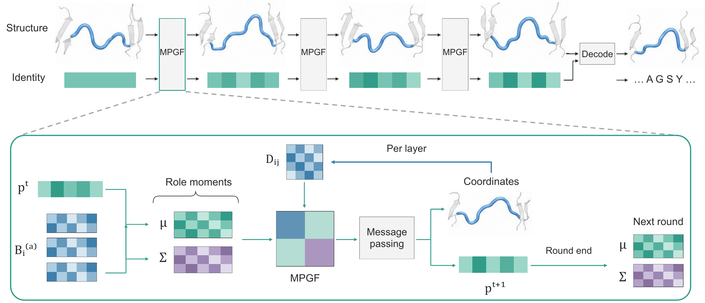

# Moment-Preserving Geometric Fusion

**MPGF** is a geometric deep learning model for joint sequence and structure generation. It combines the mean and row covariance of candidate atom roles so that uncertain identities can inform geometric message passing throughout iterative refinement.

This repository accompanies **Beyond Anonymous Atoms: Moment-Preserving Geometric Fusion for Antibody Co-Design** and provides the PyTorch model, dataset preparation, training, and inference code.



*Iterative sequence–structure refinement from the accompanying manuscript. Role moments are recomputed as identity probabilities evolve; geometric relations are recomputed as coordinates change.* [Vector PDF](assets/refinement.pdf)

[Method](#method) · [Installation](#installation) · [Data preparation](#data-preparation) · [Training](#training) · [Inference](#inference) · [Code structure](#code-structure)

## Method

At an unresolved sequence position, candidate identities interpret a shared set of coordinate slots through different weighted role matrices. Anonymous roles can collapse geometric distinctions, and mean roles can cancel opposing candidate responses. MPGF retains both the common interpretation and its variation.

For candidate roles $B_i^{(a)}$ and identity probabilities $p_i(a)$, the role moments are

$$
\mu_i=\sum_a p_i(a)B_i^{(a)},\qquad
\Sigma_i=\sum_a p_i(a)(B_i^{(a)}-\mu_i)(B_i^{(a)}-\mu_i)^\top.
$$

The ideal lifted factor and geometric relation are

$$
L_i=[\mu_i,\Sigma_i^{1/2}],\qquad F(D_{ij})=L_i^\top D_{ij}L_j.
$$

For fixed roles and factorized identity beliefs, this ideal operator preserves the expected squared change in candidate-conditioned relations without enumerating identity pairs:

$$
\lVert F(\Delta D)\rVert_F^2
=\mathbb{E}_{a,b}\left\lVert (B_i^{(a)})^\top\Delta D B_j^{(b)}\right\rVert_F^2.
$$

The implementation uses the stable covariance factor

$$
g_\epsilon(\Sigma)=(\Sigma+\epsilon I)^{1/2}-\sqrt{\epsilon}I,
$$

which preserves the covariance nullspace, followed by a bounded readout and a learned projection. The exact energy identity above applies to the ideal relation; the stable realization preserves its nullspace. The projected features drive equivariant coordinate updates and sequence predictions across refinement rounds.

## Installation

Use Linux or WSL2 with Conda. The environment specification uses Python 3.10, PyTorch 2.3.0, and `torch-scatter` 2.1.2, together with the preprocessing dependencies.

```bash
git clone https://github.com/Miso-Soup98/Moment-Preserving-Geometric-Fusion.git
cd Moment-Preserving-Geometric-Fusion
conda env create -f environment.yml
conda activate mpgf
```

Check the installed runtime and clustering tool:

```bash
python -c "import torch, torch_scatter; print('PyTorch:', torch.__version__); print('torch-scatter:', torch_scatter.__version__); print('CUDA:', torch.cuda.is_available())"
mmseqs version
```

CUDA training requires a GPU-enabled PyTorch build and a `torch-scatter` binary matching that PyTorch/CUDA combination. Use the [PyTorch 2.3 installation instructions](https://docs.pytorch.org/get-started/previous-versions/#v230) and [PyG extension installation guide](https://pytorch-geometric.readthedocs.io/en/stable/install/installation.html) when selecting binaries for your machine. If CUDA is unavailable, use `--device cpu` in the commands below.

## Data preparation

### Input files

Supply a local structure directory and a summary describing its entries. Structures and annotations can be obtained from [SAbDab](https://sabdab.opig.stats.ox.ac.uk/about). This repository does not download or bundle the dataset.

The preparation entry point accepts either:

- A TSV with `pdb`, `Hchain`, `Lchain`, `antigen_chain`, and `antigen_type` columns. Multiple antigen chains and their types are separated by `|`; protein and peptide antigens are retained.
- A JSON array or JSONL file containing the fields shown below. Convert summaries with a different schema to this format before running preparation.

```json
{"pdb":"example","heavy_chain":"H","light_chain":"L","antigen_chains":["A"]}
```

Each identifier must match a local `<pdb>.pdb` filename, and the chain identifiers must match that structure. The example above describes the input schema. Heavy and light chains must be separate. By default, structures must already use IMGT numbering; add `--renumber` to apply the bundled ANARCI-based conversion.

### Build the dataset

Run the following from the repository root, replacing the input locations with your files:

```bash
python prepare_data.py \
  --summary ../inputs/summary.jsonl \
  --pdb_dir ../inputs/pdb \
  --output ../datasets/mpgf \
  --benchmark rabd \
  --threads 4
```

Preparation validates structures, clusters CDR sequences with MMseqs2, constructs the splits, builds sharded caches, and fits the initialization template using **training entries only**.

| Setting | Default behavior |
| --- | --- |
| Clustering sequence | CDR-H3; select other loops with `--cluster_cdr` |
| Sequence identity / coverage | `0.4` / `0.8` |
| Benchmark split | Available identifiers in `data/benchmark.json` form the test set; their clusters are excluded from training and validation |
| Validation allocation | 10% of the remaining clusters, with at least one validation cluster |
| Cache shard size | 256 entries |
| Random seed | 42 |

For a custom clustered split, use `--benchmark random`; the default validation and test allocations are each 10% of clusters, with at least one cluster in each. To reserve your own test identifiers, pass `--test_ids` with a whitespace-separated text file. The random mode requires at least three clusters; benchmark mode requires test entries and at least two remaining clusters.

The output layout is:

```text
mpgf/
├── pdb/
├── train.json
├── valid.json
├── test.json
├── train_processed/
├── valid_processed/
├── test_processed/
└── template.json
```

The split manifests use one JSON object per line. The selected dataset snapshot, available structures, and clustering settings determine the resulting split. This preparation command performs CDR clustering; it does not apply antigen-sequence Strict40 filtering. Use a new or empty output directory. Preparation stops on invalid structures unless `--skip_invalid` is explicitly enabled.

## Training

### Input conditions

| Condition | Supplied context | Prediction target |
| --- | --- | --- |
| `P2-B` | Antigen/epitope coordinates, non-design sequence, lengths and numbering; a training-derived template initializes the antibody | Designed sequence and all antibody coordinates |
| `P1` | Antigen coordinates and native non-H3 antibody coordinates in the same frame | H3 sequence and coordinates; non-H3 coordinates remain fixed |

The default sequence-design region and paratope are H3. P1 requires `--cdr H3 --paratope H3` and observed, finite backbone coordinates at both H3 flanks. The epitope crop is selected during preprocessing from the declared reference complex; these commands implement epitope-conditioned tasks.

### Train MPGF

```bash
python train.py \
  --data ../datasets/mpgf \
  --output ../runs/mpgf_p2b \
  --condition P2-B \
  --device cuda:0 \
  --epochs 200 \
  --batch_size 4 \
  --seed 42
```

For P1, use a separate output directory:

```bash
python train.py \
  --data ../datasets/mpgf \
  --output ../runs/mpgf_p1 \
  --condition P1 \
  --device cuda:0 \
  --epochs 200 \
  --batch_size 4 \
  --seed 42
```

| Parameter | Default |
| --- | --- |
| Residue embedding / hidden width | 64 / 128 |
| Message-passing layers / refinement rounds | 3 / 3 |
| Neighbors | 9 |
| Dropout | 0.1 |
| Optimizer | Adam |
| Learning rate | Exponential batch schedule from `1e-4` toward `1e-5` |
| Gradient clipping | Global norm 1.0 |
| Objective | `full` |

The default `full` objective includes sequence, coordinate, backbone-bond, side-chain-bond, shadow-coordinate, and distance terms with unit coefficients. `--loss_mode seq_coord_dist` selects only sequence, coordinate, and distance losses.

Training writes `last.pt` after each completed epoch and updates `best.pt` when validation loss improves. Checkpoints contain model configuration, weights, the training template, optimizer/scheduler state, and random-number-generator states. The output directory must be empty. Training uses one CPU or CUDA device per process.

For six-CDR sequence design under P2-B, pass:

```text
--cdr H1 H2 H3 L1 L2 L3 --paratope H1 H2 H3 L1 L2 L3 --epitope_policy paratope_union --epitope_size 48
```

Here, 48 is the number of nearest antigen residues selected **per CDR** before taking the union.

### Resume an interrupted run

Resume into a new directory with the same dataset, template, architecture, condition, and training configuration. `--epochs` is the original **total epoch budget**, not an additional number of epochs. Restoration starts after the last completed epoch. Keep `best.pt` beside `last.pt` so the previous best model can be carried forward.

```bash
python train.py \
  --data ../datasets/mpgf \
  --output ../runs/mpgf_p2b_resumed \
  --condition P2-B \
  --device cuda:0 \
  --epochs 200 \
  --batch_size 4 \
  --seed 42 \
  --resume ../runs/mpgf_p2b/last.pt
```

## Inference

```bash
python generate.py \
  --checkpoint ../runs/mpgf_p2b/best.pt \
  --dataset ../datasets/mpgf/test.json \
  --output ../predictions/mpgf_p2b \
  --device cuda:0 \
  --batch_size 1 \
  --samples 1 \
  --seed 42
```

Inference restores the model's condition, design region, epitope configuration, and training template from the checkpoint. It writes one predicted complex PDB per dataset entry and sample, plus `sequences.fasta` containing the generated heavy- and light-chain sequences. Filenames follow `<entry_index>_<sample_index>.pdb`, with zero-based entry indices and one-based sample indices. Use a new or empty output directory.

Checkpoints must use the `mpgf-runtime-v1` format produced by this repository. Pretrained weights and prediction outputs are not included.

## Code structure

| Path | Purpose |
| --- | --- |
| `prepare_data.py` | Structure preparation, clustering, splits, caches, and template fitting |
| `train.py` | Training, validation, checkpoint saving, and resumption |
| `generate.py` | Model inference and output serialization |
| `runtime.py` | Model/data assembly and checkpoint loading |
| `models/` | MPGF generator, encoder, features, and message-passing layers |
| `mpgf/` | Role moments, matrix functions, stable fusion, and relation adapters |
| `data/` | Structure parsing, tensorization, input conditions, and templates |
| `utils/` | Losses, numerical checks, preprocessing helpers, and seed handling |
| `evaluation/rmsd.py` | Coordinate-alignment operations used by the model |
| `configs.py` | Numbering definitions |
| `environment.yml` | Runtime and preprocessing dependencies |

All entry-point options are available through `python prepare_data.py --help`, `python train.py --help`, and `python generate.py --help`.

## License

See [LICENSE](LICENSE) for the code license and required copyright notice.
